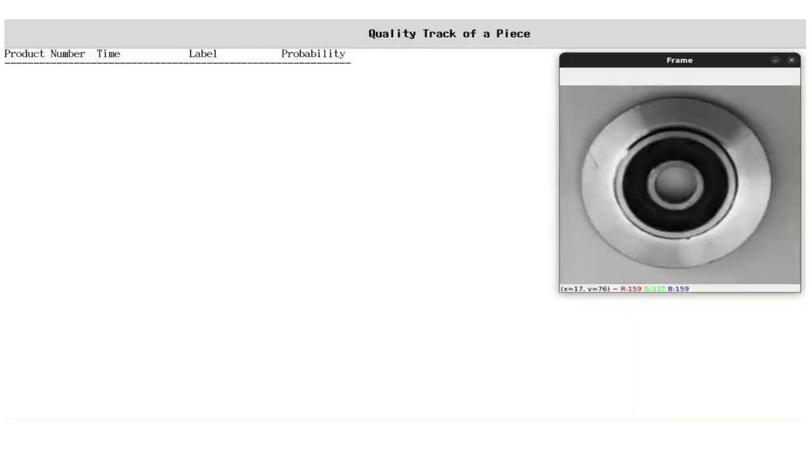
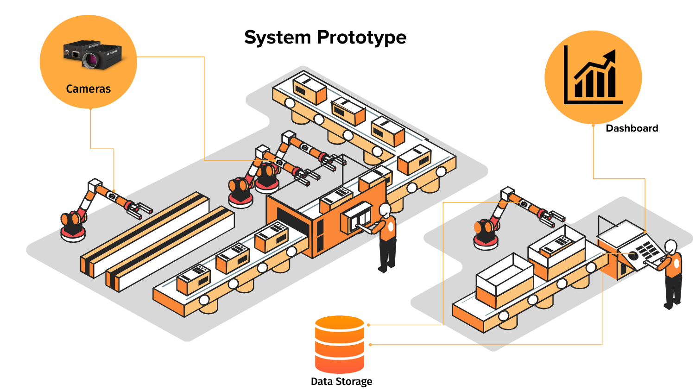
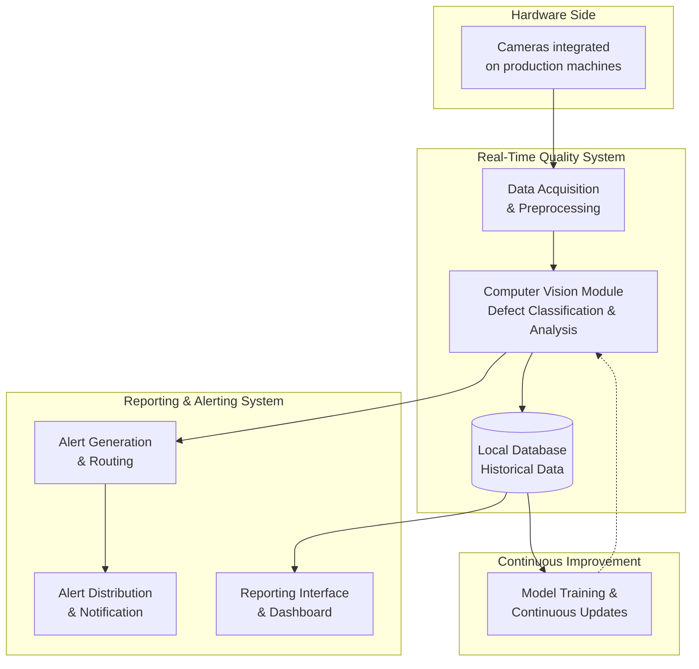
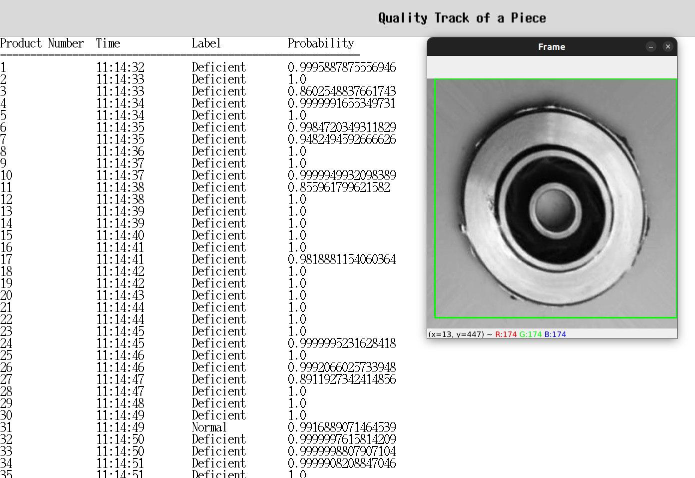
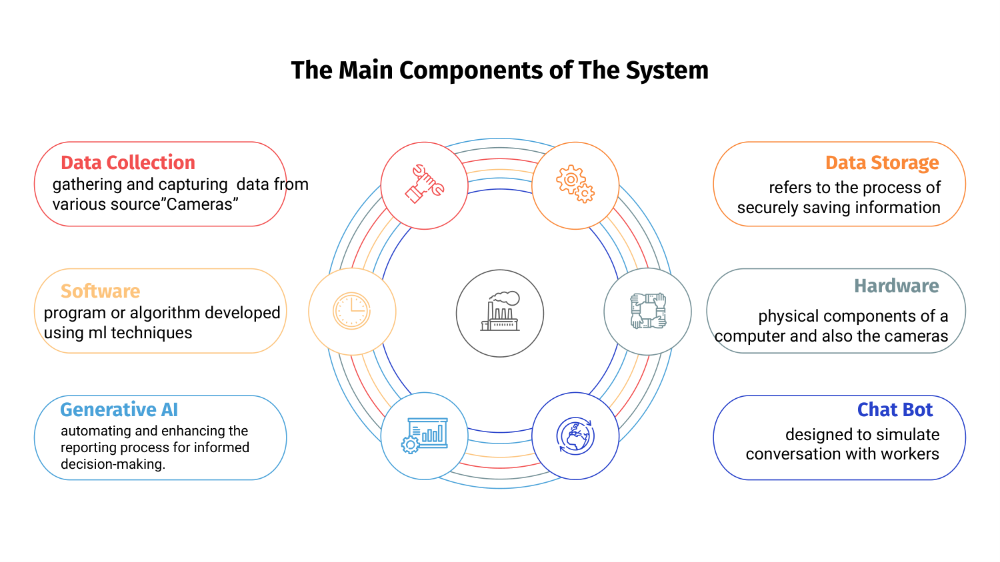
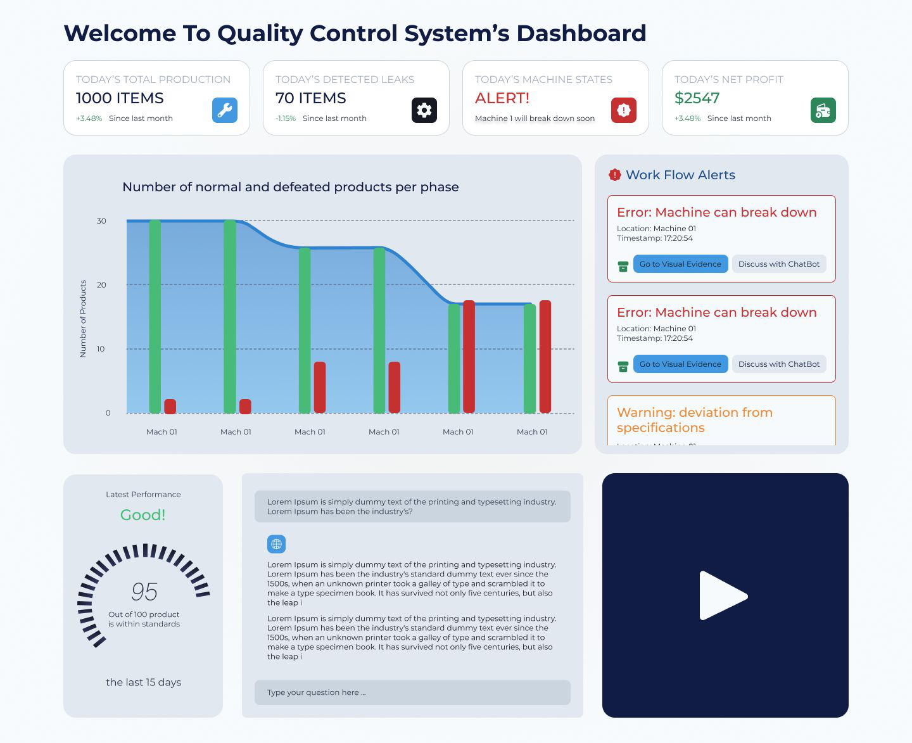

# 🔍 Quality Control System for Mechanical Components — Real-Time Computer Vision

Real-time defect detection on production lines using **computer vision** and **TinyML**. A CNN classifier inspects mechanical components (casting products) on a conveyor, labels each piece **`Normal` / `Deficient`** with a confidence probability, and streams the results live — all running locally on lightweight, edge-friendly **TensorFlow Lite** models.



## ✨ Highlights

- 🧠 **CNN defect classifier** trained on a real industrial casting dataset (Kaggle)
- ⚡ **TinyML-ready**: quantized TFLite models down to **~233 KB** — runs on Raspberry Pi & Coral Edge TPU
- 🎥 **Real-time pipeline**: OpenCV MIL object tracking + live TFLite inference + Tkinter monitoring GUI
- 📊 Live log of **product number, timestamp, label, probability** for every inspected piece
- 🏭 Built as a full **Industry 4.0 quality-control platform**: cameras → vision module → database → dashboard → alerts

## 🎯 The Problem

Manual visual inspection is slow, inconsistent, and expensive — and most factories have no data to improve.



| 💸 | Cost of quality = **15–40%** of total business costs (prevention, detection, correction) |
|---|---|
| 🔁 | Reworking a defective product costs **2–5×** more than making it right the first time |
| 🗑️ | Material wastage from defects: **5–20%** of total production |
| ⏱️ | Unplanned downtime averages **$260,000/hour** (Aberdeen Group) |

## 🏗️ System Architecture



## 📁 Repository Structure

```
├── Quality control on production lines with TinyML_v2.ipynb   # Training notebook (CNN + quantization)
├── opencv_object_tracking.py      # Real-time detection script (OpenCV + TFLite + Tkinter GUI)
├── casting_test.mp4               # Demo video built from the dataset's test images
├── saved_models/                  # Pre-trained models — no training needed!
│   ├── cnn_model_s.h5                    # Keras model (~14 MB)
│   ├── cnn_model_vs.tflite               # Very-small TFLite model (~0.9 MB) ⭐
│   ├── cnn_model_s_quant.tflite          # Post-training quantized (~1.2 MB)
│   ├── cnn_model_quant.tflite            # Quantized (~5 MB)
│   ├── cnn_model_quant_aware.tflite      # Quantization-aware trained (~5 MB)
│   └── cnn_model_vs_quant_aware.tflite   # Very-small + QAT (~233 KB) 🚀
├── requirements.txt
└── output.png
```

## 🚀 Quick Start — Local Testing (No Training Needed!)

The models are **already trained**. Just clone and run:

```bash
# 1. Clone the repo
git clone https://github.com/Yasmina3/Quality-control-system-Computer-vision.git
cd Quality-control-system-Computer-vision

# 2. Set up a virtual environment
python -m venv venv
source venv/bin/activate          # Windows: venv\Scripts\activate

# 3. Install dependencies
pip install -r requirements.txt   # imutils, opencv-python, tflite-runtime

# 4. Run the real-time demo
python opencv_object_tracking.py --video casting_test.mp4 --model cnn_model_vs.tflite
```

> 💡 The model file must exist in `saved_models/` under the exact name you pass to `--model` (e.g. `cnn_model_vs.tflite`). You can also **omit `--video`** to use a live webcam feed!

### 🎮 Controls

| Key | Action |
|---|---|
| `s` | Pause video & select the component's ROI (bounding box) with the mouse |
| `Enter` / `Space` | Confirm ROI → tracking + classification start |
| `s` again | Pause the stream |
| `c` | Stop the system completely |
| `q` | Quit the video window |

A **"Quality Track of a Piece"** window appears and logs every inspected product:

```
Product Number      Time        Label         Probability
------------------------------------------------------------
1                   11:14:32    Normal        0.9995
2                   11:14:33    Deficient     0.8602
...
```



## 📓 Retrain the Model (Optional)

1. Download the dataset from Kaggle: [Real-life industrial dataset of casting product](https://www.kaggle.com/datasets/ravirajsinh45/real-life-industrial-dataset-of-casting-product)
2. Unzip it and place the `casting_data` folder (with `train` and `test` subfolders) in the repository root
3. Open `Quality control on production lines with TinyML_v2.ipynb` and run all cells

> ⚠️ Running the notebook **overwrites** the models in `saved_models/`.

The notebook covers: CNN training → evaluation → **post-training quantization** → **quantization-aware training** → TFLite export, letting you trade accuracy for size depending on your target hardware.

## 🧩 Beyond the Script — The Full Platform Vision

This repository is the **computer-vision core** of a complete real-time quality-control platform:



- 📷 **Hardware**: machine-vision area-scan cameras or smart cameras (camera + processor + inference on-device)
- 💾 **Data storage**: local servers, private cloud, or hybrid solutions — historical data feeds continuous learning
- 📊 **Dashboard & alerting**: production KPIs, defect trends per machine, workflow alerts with visual evidence
- 🤖 **Chatbot**: workers can ask questions about defects and machine state in natural language
- ✍️ **Generative AI reports**: automatic NLG reports with contextual insights from historical data



## 🔧 Tech Stack

| Layer | Tools |
|---|---|
| Deep learning | TensorFlow / Keras, CNN classifier |
| Edge inference | TensorFlow Lite (`tflite-runtime`), int8 quantization |
| Vision & tracking | OpenCV 4.5, MIL tracker, imutils |
| GUI | Tkinter (live monitoring window) |
| Deployment targets | Linux embedded devices — **Raspberry Pi**, **Coral Edge TPU**, and similar |

## 🌍 Market Context

Real-time computer-vision quality control is a **blue-ocean opportunity in Algeria**: the technology is not yet implemented locally, while Industry 4.0 adoption and regulatory pressure create strong demand. Key challenges ahead are implementation cost, integration complexity, and workforce upskilling.

## 🔮 Roadmap

- [ ] Multi-camera support & automatic ROI detection (no manual selection)
- [ ] Full dashboard + alert routing service
- [ ] Chatbot integration for factory workers (API-based)
- [ ] Generative-AI daily/weekly quality reports
- [ ] Feedback loop: production data → automatic retraining
- [ ] Packaging as a plug-and-play appliance for Algerian factories

## 📜 License

This project was developed for educational and prototyping purposes. Feel free to reuse with attribution.

---
<p align="center">Built by the <b>InnoBytes</b> team — bringing Industry 4.0 quality control to Algeria 🇩🇿</p>
